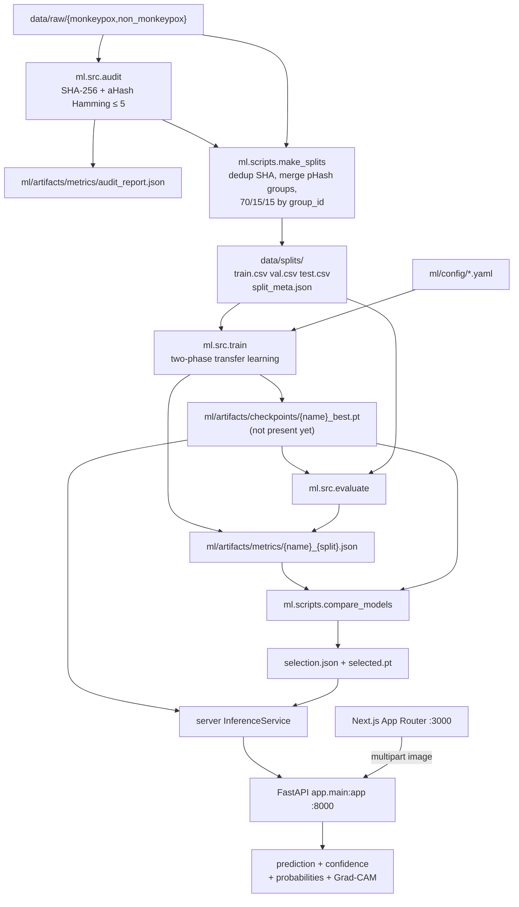
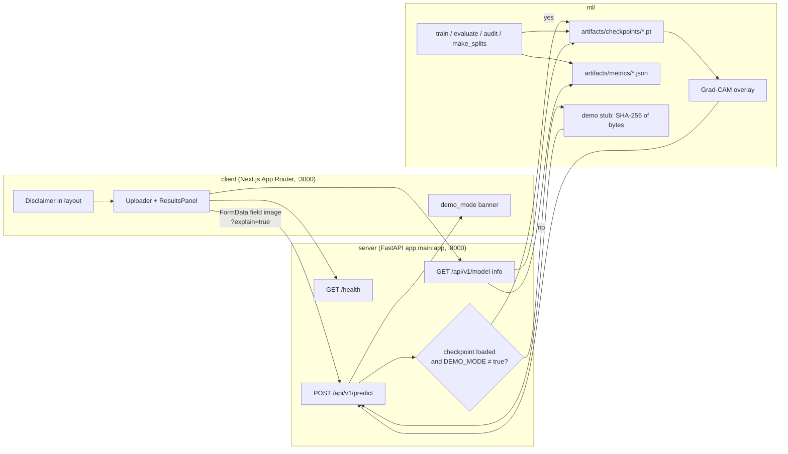
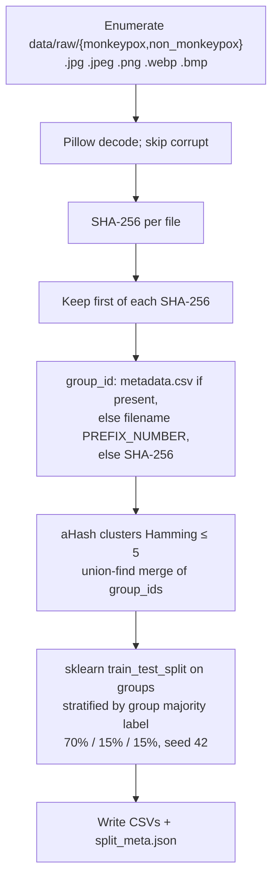
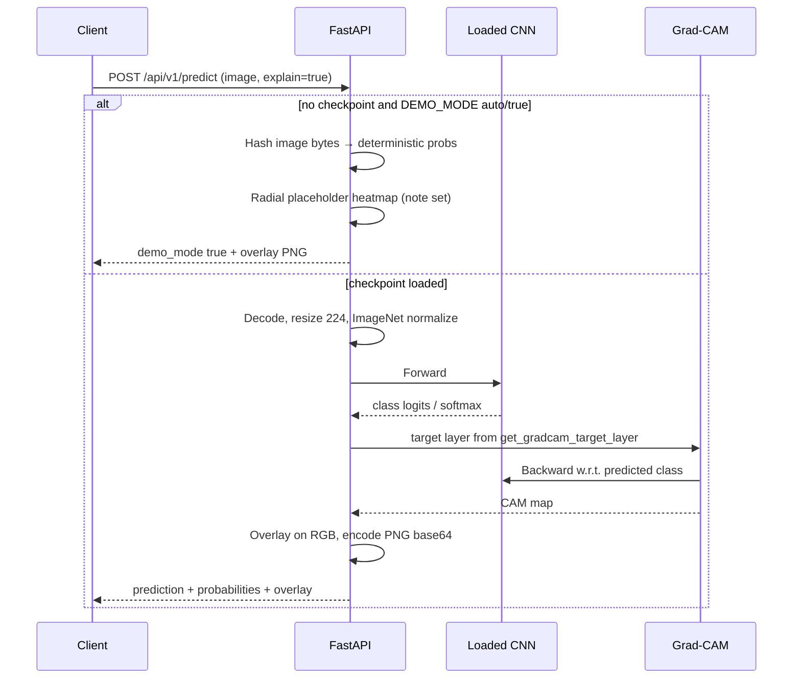

# Architecture

Pox Scanner is a three-tier research stack: a Next.js client, a FastAPI inference service, and a PyTorch training/evaluation package. Interfaces are defined in [contracts.md](contracts.md).

The system classifies one RGB lesion image into `{non_monkeypox, monkeypox}` (display labels `Non-Monkeypox` / `Monkeypox`). It is not a diagnostic device.

**Research and educational use only. This tool does not provide a medical diagnosis.** Softmax scores and Grad-CAM overlays are not a case definition and must not be used for isolation, treatment, vaccination, or reporting. See [ethics-and-limitations.md](ethics-and-limitations.md).

## Current snapshot (local workspace)

This section records what is on disk today, not a target state. Do not treat placeholder JSON as trained results.

| Artifact | Actual state |
| --- | --- |
| `data/raw/` | **Not empty.** Audit scanned 7 518 valid JPEGs: 2 828 `monkeypox`, 4 690 `non_monkeypox`. Images are gitignored (`data/raw/**/*.jpg` and related patterns) but present locally under `data/raw/{monkeypox,non_monkeypox}/`. |
| `data/splits/` | **Exists.** `train.csv`, `val.csv`, `test.csv`, `split_meta.json` (seed 42, 70/15/15 by group). |
| `ml/artifacts/checkpoints/` | Training in progress. A mid-run `efficientnet_b0_best.pt` may appear; `selected.pt` and `model_manifest.json` are absent. **Not MODEL_GATE_READY.** Default `DEMO_MODE=auto` still stubs until a checkpoint is actually loaded. |
| `ml/artifacts/metrics/*_test.json` | Placeholder files for the four backbones. Numeric fields are **null**, `n_samples` is `0`, `confusion_matrix` is `[[null, null], [null, null]]`. The `notes` string still says `"Pending training — no dataset."` (stale relative to `data/raw`). |
| `ml/artifacts/metrics/selection.json` | `status: "pending_training"`, `selected_model` / `checkpoint` null, `ranking: []`. |
| Training | In progress (Claude, `efficientnet_b0`). Do not treat a partial `*_best.pt` as a selected or evaluated model. `/health` remains `demo_mode: true` until load succeeds. |

`data/processed/` is unused. A repo-root `Data.csv` is not referenced by the ML or API code.

## End-to-end pipeline



Today the path stops at **splits ready, checkpoint missing**: the adapter takes the demo-stub branch (hash of image bytes + placeholder heatmap) instead of `ml.src.predict` / Grad-CAM.

## Component diagram



Compose project name: `poxscanner`. Service **`server`** listens on 8000 (`WORKDIR /app/server`, `PYTHONPATH=/app:/app/server`, `uvicorn app.main:app`). Service **`client`** listens on 3000. The client reads `NEXT_PUBLIC_API_BASE_URL` (fallback `NEXT_PUBLIC_API_URL`, then `http://localhost:8000`). Browsers on the host call `http://localhost:8000` unless a reverse proxy is added; Compose inlines that URL at image **build** time, so it must be a URL the browser can reach, not `http://server:8000`.

## Repository layout

| Path | Role |
| --- | --- |
| `client/` | Next.js 15 + TypeScript App Router UI (`poxscanner-web`). Shared types in `client/types/api.ts`. |
| `server/` | FastAPI app `app.main:app`. CORS from `CORS_ORIGINS` (default `http://localhost:3000`). |
| `ml/src/` | Audit, duplicates, splits, transforms, architectures, train, evaluate, predict, Grad-CAM. |
| `ml/config/` | Per-backbone YAML (`efficientnet_b0`, `densenet121`, `resnet50`, `mobilenet_v3_small`) plus `base.yaml`. |
| `ml/artifacts/` | Checkpoints (empty), metrics JSON, plots (empty until evaluate/train write them). |
| `data/raw/` | Training images by class. Locally populated; image binaries are gitignored. |
| `data/splits/` | Manifests only (`train.csv`, `val.csv`, `test.csv`, `split_meta.json`). |

Class encoding used throughout ML and inference:

```
LABEL_TO_INDEX = {"non_monkeypox": 0, "monkeypox": 1}
INDEX_TO_LABEL = {0: "non_monkeypox", 1: "monkeypox"}
DISPLAY = {"non_monkeypox": "Non-Monkeypox", "monkeypox": "Monkeypox"}
```

Positive class for recall / sensitivity / PR-AUC: **monkeypox (1)**.

## Dataset → audit → leakage-safe split



### Audit (`python -m ml.src.audit`)

Scans class folders, validates with Pillow, computes SHA-256 and 8×8 average hash, writes `ml/artifacts/metrics/audit_report.json` and `.txt`. Exit code 2 if no candidate files (does not fabricate images). Status is `"issues"` if any corrupt files or **cross-class** exact/near duplicates exist; otherwise `"ok"`.

Latest local audit (`scanned_at` 2026-08-28T11:50:30Z):

- 7 518 files, all valid JPEGs, 0 corrupt
- Imbalance ratio ≈ 1.66 (`non_monkeypox` / `monkeypox`)
- 602 exact SHA-256 duplicate groups (typically `*_13.jpg` paired with `*_ORIGINAL.jpg`)
- 849 near-duplicate groups (aHash Hamming ≤ 5)
- 0 cross-class identical SHA-256 groups
- 23 cross-class near-duplicate groups (union-find is transitive, so some clusters span Hamming well above 5)

### Splits (`python -m ml.scripts.make_splits` → `ml.src.dataset.make_splits`)

CSV columns: `path,label,split,sha256,width,height,group_id`. Paths are repo-relative POSIX.

Implemented policy:

1. Drop exact SHA-256 duplicates (keep one).
2. Merge `group_id`s for aHash near-duplicates (Hamming ≤ 5, transitive).
3. If `data/raw/metadata.csv` with `path,group_id` exists, use it; **this run did not** (`used_metadata_csv: false`).
4. Else derive `group_id` from filenames matching `PREFIX_NUMBER` (e.g. `MKP_17_01_8.jpg` → `MKP_17`). This run used filename grouping for all 7 518 enumerated files.
5. Split **groups**, not images, 70/15/15 stratified by the group's majority label. Same SHA-256 or merged pHash group cannot appear in two splits.

`split_meta.json` (actual):

| Field | Value |
| --- | --- |
| seed / ratios | 42 / 0.70 / 0.15 / 0.15 |
| n_enumerated | 7 518 |
| n_exact_duplicates_removed | 602 |
| n_kept | 6 916 |
| n_groups | 127 |
| n_train / n_val / n_test | 6 374 / 272 / 270 |
| train by class | monkeypox 2 502, non_monkeypox 3 872 |
| val by class | monkeypox 52, non_monkeypox 220 |
| test by class | monkeypox 52, non_monkeypox 218 |
| used_near_duplicates | true |

Near-duplicate merging collapses many filename prefixes into 127 groups, so val/test row counts are small relative to 15% of images. `ml.src.train` refuses to start if any of `train.csv` / `val.csv` / `test.csv` is missing or empty.

## PyTorch models and training

Registered names in `ml.src.models`: `efficientnet_b0`, `densenet121`, `resnet50`, `mobilenet_v3_small`. Each `ml/src/architectures/*.py` module exposes `build(...)` and `get_target_layer(...)`. ImageNet pretrained weights are used when `pretrained: true` in YAML; the classification head is replaced with dropout + linear to 2 classes.

Transforms (`ml.src.transforms.build_transforms`):

- **Train:** resize 224, HFlip p=0.5, rotation ±10°, random resized crop scale 0.85–1.0, brightness/contrast jitter 0.1, ImageNet mean/std. No vertical flip, elastic deform, or heavy color jitter.
- **Val / test / inference:** resize 224, center crop 224, ImageNet normalize.

`ml.src.train` (CLI: `python -m ml.src.train --model NAME` or `--config PATH`):

- Seeds Python, NumPy, PyTorch; `cudnn.deterministic = True`, `cudnn.benchmark = False`.
- Phase 1 (`freeze_epochs`, default 5): freeze backbone, train head (AdamW, `lr_head`).
- Phase 2: unfreeze last backbone stage(s) + head (`lr_backbone` / `lr_head`).
- Loss: `CrossEntropyLoss`. Early stop on **val recall of monkeypox** (patience 7). Mixed precision only if YAML `mixed_precision` and CUDA.
- Writes `ml/artifacts/checkpoints/{model.name}_best.pt` with payload `model_name`, `state_dict`, `config`, `val_metrics`, `epoch`, `seed`, `class_to_idx`, `image_size` (224), `version` (`0.1.0`).
- Also writes `{name}_train.json` / `{name}_val.json` and training-curve plots. **None of those checkpoint or plot files exist yet.**

`ml.src.evaluate` loads a checkpoint, scores a split CSV, writes `{name}_{split}.json` with real numbers and plots. `ml.scripts.compare_models` ranks completed test JSONs (completed = `accuracy is not None`) by monkeypox recall, F1, ROC-AUC, PR-AUC, specificity, |val−test| F1 gap, latency; copies the winner to `selected.pt`. With only null placeholders it writes `pending_training`.

## Inference adapter (`server/app/services/inference.py`)

Torch and `ml.src` are imported **only when a checkpoint is actually loaded**, so tests that stay in demo mode do not require PyTorch.

On API startup (`lifespan`) and again on `/health`, `InferenceService.try_load()` runs once:

1. If `DEMO_MODE=true` (also `1` / `yes`): skip load; stay on stub.
2. Else resolve a checkpoint path (see below). If none, stay unloaded.
3. Else `ml.src.predict.load_checkpoint` → `model_loaded = true`.

`using_demo` / response `demo_mode`:

| `DEMO_MODE` | Behavior |
| --- | --- |
| `auto` (default) | Demo if no checkpoint was loaded |
| `true` | Always stub, even if a `.pt` exists (load is skipped) |
| `false` | Require checkpoint; `POST /predict` returns 503 `model_unavailable` if none |

`predict()`:

- Demo branch: `demo_probabilities(image_bytes)` — SHA-256 digest → two logits in `[-4, 4]` from the first 16 bytes → softmax. Deterministic for given bytes. Display label is the argmax; `confidence` is that class’s probability. `demo_mode: true`. `model` is `selection.json.selected_model` if set, else `efficientnet_b0`.
- Real branch: `ml.src.predict.predict_image` (RGB → val/inference transform → softmax). `demo_mode: false`. `model` / `version` come from the checkpoint payload.

Both branches return display `prediction`, `confidence` in `[0, 1]`, `probabilities` for both classes, `disclaimer`, and optional `explanation`.

## API endpoints

Base: FastAPI `app.main:app` from `server/`. Version `0.1.0` (`APP_VERSION`). Router prefix `/api/v1`. CORS origins from `CORS_ORIGINS` (comma-separated); default `http://localhost:3000`. Credentials allowed unless an origin is `*`.

### `GET /health`

```json
{
  "status": "ok",
  "service": "poxscanner-api",
  "model_loaded": false,
  "demo_mode": true,
  "version": "0.1.0"
}
```

`model_loaded` is true only when a real checkpoint was loaded. With no `.pt` and `DEMO_MODE=auto`, the live shape is the example above.

### `GET /api/v1/model-info`

Reports `name`, `version`, `task: binary_skin_lesion_classification`, `classes: ["non_monkeypox", "monkeypox"]`, input size 224 and MIME allowlist, `metrics` (null until a **loaded** model has a matching `{name}_{test|val}.json`), `selection_status` (`pending_training` until `compare_models` writes a selection), `demo_mode`, and the research disclaimer.

When a checkpoint exists, `name` comes from the checkpoint, `metrics` from the matching metrics file if present, and `demo_mode` is false (unless `DEMO_MODE=true`).

Placeholder `*_test.json` files are **not** served as `metrics` while no checkpoint is loaded.

### `POST /api/v1/predict`

`multipart/form-data` field: `image`. Optional query `explain` (default **true**).

Success `200`: display `prediction`, `confidence` in `[0, 1]` (probability of the predicted class), `probabilities` for both classes (sum ≈ 1), `model`, `version`, `demo_mode`, disclaimer, and `explanation` (`method: gradcam`, `overlay_png_base64`, `note`) when `explain=true`. If `explain=false`, `explanation` is `null`.

Validation (`server/app/utils/images.py`): MIME allowlist `image/jpeg`, `image/png`, `image/webp`; max size `MAX_UPLOAD_BYTES` (default 8 000 000); decode with Pillow; declared MIME must match decoded format; longest side ≤ 4096 px; ignore client filename; do not write to disk unless `STORE_UPLOADS=true` (then `server/var/uploads/{uuid}.{ext}`).

Errors (JSON `{ "error": { "code", "message" } }`):

| Status | Code |
| --- | --- |
| 400 | `invalid_image`, `unsupported_media_type`, `empty_file` |
| 413 | `file_too_large` |
| 422 | `validation_error` |
| 503 | `model_unavailable` only if demo mode is disabled **and** no checkpoint exists (or a loaded model returns an unexpected probability payload) |

## Checkpoint resolution

Default path: `MODEL_CHECKPOINT` if that path exists (absolute, or relative to `server/` or repo root). Else `ml/artifacts/checkpoints/selected.pt`. If missing, use `selection.json` `checkpoint` field, else the first `*_best.pt` in that directory (sorted). Currently all of these miss, so resolution returns `None`.

Checkpoint payload includes `model_name`, `state_dict`, `config`, `val_metrics`, `epoch`, `seed`, `class_to_idx`, `image_size` (224), `version`.

Compose mounts `./ml/artifacts/checkpoints` read-only into the API container so a later `*_best.pt` is visible without rebuilding.

## Grad-CAM flow



Target layers (from architecture modules): EfficientNet-B0 and MobileNetV3-Small last `features` block (`model.features[-1]`); ResNet-50 `layer4`; DenseNet-121 `features.denseblock4`. Overlay is a visualization of gradient-weighted activations, not a causal explanation of disease (see [ethics-and-limitations.md](ethics-and-limitations.md)).

If real Grad-CAM throws, the adapter falls back to the same placeholder overlay with `note`: `"Grad-CAM unavailable; placeholder overlay shown."`

## Demo mode

Env `DEMO_MODE=auto|true|false` (default `auto`):

- `auto`: stub if no file at the resolved checkpoint path (current local default)
- `true`: always stub (frontend/dev); checkpoint load is skipped
- `false`: require checkpoint; otherwise 503

Stub inference is **deterministic for given image bytes** (hash-based probabilities), flagged `demo_mode: true`, and must not be described as a trained clinical model.

Placeholder Grad-CAM (`placeholder_overlay_b64`): SHA-256 bytes 16–17 pick a radial center; a jet-like heatmap is blended onto the RGB upload (`alpha` scales with the CAM). `explanation.note` is:

`Placeholder heatmap (demo mode). Not a trained Grad-CAM explanation.`

The Next.js banner copy is: *Demo mode — no trained checkpoint loaded. Results are placeholders, not model output.*

## Frontend contract

- Next.js App Router. `API_BASE` = `NEXT_PUBLIC_API_BASE_URL` or `NEXT_PUBLIC_API_URL` or `http://localhost:8000`
- `GET ${API}/health` and `GET ${API}/api/v1/model-info` from `Header` (reachability + model name)
- `POST ${API}/api/v1/predict?explain=true` with FormData field `image`
- Client-side file checks: JPEG/PNG/WebP, max 8 MB (mirrors API allowlist; the API still re-validates)
- Show a demo-mode banner when `health.demo_mode` or `response.demo_mode` is true
- `ResultsPanel` shows display prediction, confidence percent, probability bars, original image, and Grad-CAM overlay (`data:image/png;base64,...`) plus `explanation.note` when set
- Disclaimer always visible in `layout.tsx`: *Research and educational use only. This tool does not provide a medical diagnosis.*
